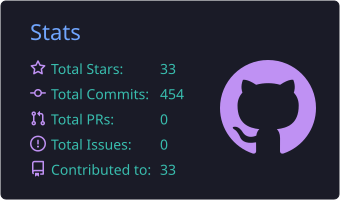
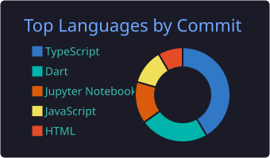
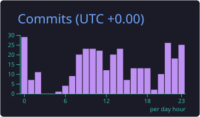
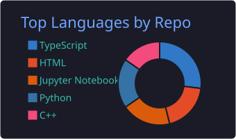

  

  &nbsp;
  &nbsp;
  &nbsp;
  

---

### 🚀 About Me

- 🎓 Studying **AI & Big Data** at the Polytechnic School of Lomé — University of Lomé
- 🤖 **AI & ML Engineer**: machine learning, deep learning, data pipelines and **Generative AI** (LLMs, RAG, prompt engineering, LangChain)
- 💼 Interned in **Generative AI & Data Science** (Mawaba Technologies) and **Machine Learning** (AnalystLab Africa)
- 🌍 Volunteer web developer for social-impact projects at Neuractif Initiatives
- 📫 Reach me at **nethaniahdjossou@gmail.com**

---

### 🛠️ Tech Stack

  
  
  
  
  
  
  
  
  
  
  
  
   
  
  
  
  
  
  
  
  
  
  

---

### 📌 Featured Projects

| Project | Description | Stack |
|---|---|---|
| 🧠 **[Oren](https://oren-agent.vercel.app/)** | AI assistant for small businesses in francophone Africa: a restaurant owner in Lomé uploads a menu photo or a few documents, or answers an AI interview by voice, and gets a customer-facing assistant in under an hour | Next.js, TypeScript, Supabase, Tailwind CSS, Meta Model API |
| 🚢 **Titanic Predictive Modeling** | Full data science pipeline: EDA, visualization, model training | Pandas, Matplotlib, scikit-learn |
| 🍔 **FoodOrderBot** | Conversational agent automating restaurant order-taking | Python, LangChain, Gemini, Chainlit |
| 📊 **Credit Scoring** | Machine learning model predicting payment default | Machine Learning |
| 🩺 **[PulseAI](https://pulse-34ai.vercel.app)** | AI-driven medical diagnosis & hospital routing prototype for Africa | FastAPI, Mistral, Supabase, Flutter |
| 🎓 **[Boursio](https://boursio.web.app)** | AI platform helping African students find and apply for scholarships | — |
| 🩹 **[Miabe Assistant](https://miabe-assistant.web.app)** | Study assistant for STEM students — chatbot plus a library of course materials and exercises | — |

---

### 📊 GitHub Stats

  
  

  
  

  
  

  

---

<i>Open to internships and collaborations in AI / Machine Learning / Generative AI 🚀</i>

